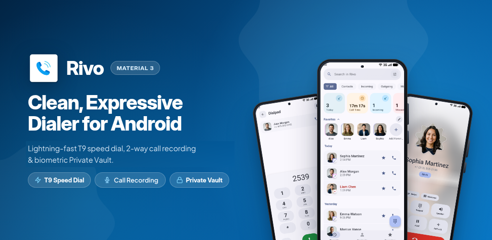
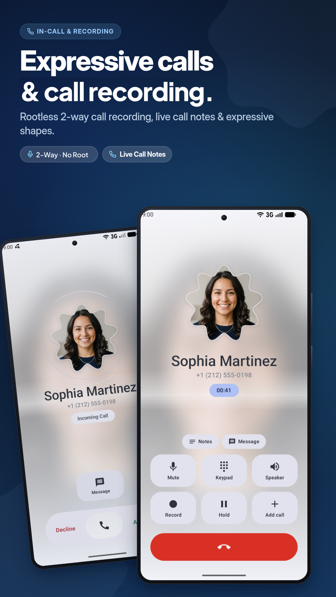

# Rivo

A clean, modern dialer and contacts app for Android, built with Jetpack Compose.

  

  
  &nbsp;
  
  &nbsp;
  
  &nbsp;
  
   

> [!NOTE]  
> **Release Channels:** Official **Stable** releases are distributed on **[Google Play](https://play.google.com/store/apps/details?id=com.grinch.rivo4)**, while automated **Beta** APKs compiled directly from the latest codebase are published on **[GitHub Releases](https://github.com/user-grinch/RivoPhone/releases)**. Join our **[Discord Server](https://discord.gg/NtEvU3726e)** to discuss upcoming features and chat with the community!

---

## Features

- **T9 Search & Speed Dial**: Quick contact lookup by name or number right on the keypad, plus 1–9 speed dial shortcuts.
- **Dual SIM Support**: Outbound SIM selector, per-contact preferred SIM memory, and carrier tags.
- **Call Recording**: Rootless 2-way call audio recording via the **Rivo Recorder** companion app (Wireless Debugging setup), with auto-record rules, auto-cleanup, and local playback management.
- **In-Call Screen**: Audio routing (earpiece, speaker, Bluetooth, wired headset), hold, mute, in-call dialpad, and call notes.
- **Call Notifications**: Android-native heads-up notifications with answer, decline, and speaker toggles.
- **Private Contacts Vault**: Keep specific contacts, their call history, and notifications locked behind biometrics or device PIN.
- **Contact Management**: Edit multiple numbers, emails, and addresses per contact with custom labels, contact deduplication, and local or cloud account storage.
- **Fake Incoming Call**: Simulate an incoming call with custom caller name, number, ringtone, and timer.
- **Blocklist**: Block spam numbers directly from call logs or contact details.
- **Customization**: Material You dynamic color theming, configurable dialpad layouts, avatar shapes, and app-level biometric lock.

## Screenshots

  
  
  
  

  
  
  
  

---

## Downloads

- **Stable (Google Play — Recommended)**: Download the official stable release from [Google Play](https://play.google.com/store/apps/details?id=com.grinch.rivo4).
- **Beta (GitHub Releases — Direct APK)**: Automated beta APK builds compiled directly from the latest `main` branch are published under [GitHub Releases](https://github.com/user-grinch/RivoPhone/releases).
  - Download [RivoPhone.apk (Beta)](https://github.com/user-grinch/RivoPhone/releases/download/beta/RivoPhone.apk)
  - Download [RivoRecorder.apk (Companion Call Recorder — Beta)](https://github.com/user-grinch/RivoPhone/releases/download/beta/RivoRecorder.apk)
- **Discord Community**: Join our [Discord Server](https://discord.gg/NtEvU3726e) to discuss upcoming features, share feedback on beta builds, and report issues.

## License

Copyright &copy; 2025&ndash;2026 Grinch_. All rights reserved.
